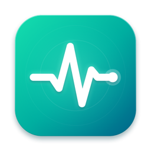

<p align="center">
  
</p>

<h1 align="center">PulseAwake</h1>

<p align="center">
  <strong>极简、零依赖的原生 macOS 菜单栏活跃守护与合盖防休眠工具</strong><br/>
  防止桌面 IM（企业微信 / 飞书 / 钉钉 / Slack / Teams）自动切为“离开”，一键管理屏幕常亮、系统防休眠与笔记本合盖运行。
</p>

<p align="center">
  <a href="https://github.com/gitEle/PulseAwake/releases"></a>
  
  
  
  <a href="LICENSE"></a>
</p>

<p align="center">
  <strong>简体中文</strong> | <a href="README_EN.md">English</a>
</p>

---

## 核心特性

- **智能无感防离开（Idle Pulse）**：仅当系统真实无键鼠输入达到设定阈值（默认 `90s`，支持 `30s ~ 300s` 多档切换）且鼠标按键未按下时，才发送一次非阻塞 `1px` 微脉冲重置 `CGEventSource` 空闲计时。日常操作电脑期间完全不触发、零干扰。
- **开盖防休眠与屏幕常亮**：底层直接调用 macOS `IOKit` 独立管理 `NoIdleSleepAssertion`（阻止系统空闲睡眠）与 `NoDisplaySleepAssertion`（阻止屏幕熄屏锁屏），完全替代终端 `caffeinate` 命令。
- **未接外屏合盖不休眠（Clamshell Mode）**：支持在不连接外接显示器的情况下合上 MacBook 盖子继续后台运行；直读内核 `IOPMrootDomain` 实时同步状态，并内置**退出前防遗忘安全提醒护栏**，避免装包发热耗电。
- **诚实透明的权限状态机**：实时检测 `AXIsProcessTrusted()` 辅助功能授权状态；未授权时状态栏自动切换 `⚠️` 提醒并提供一键跳转系统设置入口，绝不静默失效或虚报计数。
- **极简原生架构**：纯 Swift 核心、零第三方依赖、纯 CoreGraphics 矢量图标生成，`arm64 + x86_64` 通用二进制内存占用低于 `30MB`，内置 `SMAppService` 登录自启开关。

---

## 快速安装（Releases 预编译包）

1. 前往 [Releases](https://github.com/gitEle/PulseAwake/releases) 下载最新通用包 `PulseAwake-v*-macos-universal.zip` 并解压。
2. 将 **`PulseAwake.app`** 拖入系统的 **`/Applications`（应用程序）** 目录。
3. 首次启动前打开 **终端（Terminal）** 执行一行命令解除 macOS 未公证隔离标记并运行（仅首次安装需执行）：
   ```bash
   xattr -cr /Applications/PulseAwake.app && open /Applications/PulseAwake.app
   ```
4. 根据系统弹窗（或点击菜单栏 `⚠️` 图标 → **“授权辅助功能权限…”**），在 **系统设置 → 隐私与安全性 → 辅助功能** 中打开 **`PulseAwake`** 开关即可生效。

---

## 菜单与功能对照

| 菜单项 | 作用 | 底层机制 |
| :--- | :--- | :--- |
| **空闲保活（防自动离开）** | 重置系统 HID 空闲时间，防止 IM 自动变“离开/挂机” | `CGEventSource` 空闲检测 + `1px` 微位移 |
| **阻止系统休眠** | 阻止开盖空闲进入睡眠（适合跑长任务、下载、编译） | IOKit `NoIdleSleepAssertion`（等效 `caffeinate -i`） |
| **阻止屏幕休眠** | 保持屏幕常亮不息屏锁屏 | IOKit `NoDisplaySleepAssertion`（等效 `caffeinate -d`） |
| **阻止合盖休眠** | 未接外屏合上笔记本盖子仍保持运行（需管理员授权） | `IOPMrootDomain` `SleepDisabled`（`pmset disablesleep`） |
| **开机自动启动** | 随用户登录自动驻留菜单栏（无 Dock 图标） | `ServiceManagement` (`SMAppService.mainApp`) |

> **安全提示**：开启“阻止合盖休眠”后，把 MacBook 放进双肩包/内胆包前请务必在菜单中取消勾选（或在退出 `PulseAwake` 弹窗中选择 **“恢复正常休眠并退出”**），以免密闭空间持续运行导致机身发热与电量耗尽。

### 菜单栏图标状态对照
- **实心心电脉冲框**：保活或任一防休眠正在运行中
- **空心心电脉冲框**：所有功能均已暂停
- **三角感叹号 `⚠️`**：已开启空闲保活，但尚未授予辅助功能权限

---

## 从源码构建

环境要求：macOS 13.0+ 及 Xcode Command Line Tools（`xcode-select --install`）。

```bash
git clone https://github.com/gitEle/PulseAwake.git
cd PulseAwake

# 编译双架构通用应用并部署到本机 /Applications/PulseAwake.app
./build.sh

# 构建用于发布的通用压缩包与 SHA256 校验文件 (输出至 dist/)
./build.sh --dist
```

---

## 彻底卸载

1. 在菜单栏确保 **“阻止合盖休眠”** 与 **“开机自动启动”** 已关闭，点击 **“退出 PulseAwake”**；
2. 删除 `/Applications/PulseAwake.app`；
3. （可选）清理偏好配置：`defaults delete com.gitele.pulseawake`。

---

## License

本项目基于 [MIT License](LICENSE) 开源。
