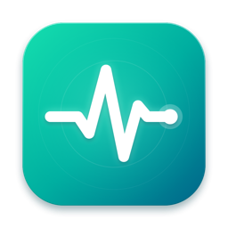

<p align="center">
  
</p>

<h1 align="center">PulseAwake</h1>

<p align="center">
  <strong>Minimal, zero-dependency native macOS menu bar utility for idle keep-alive &amp; clamshell awake</strong><br/>
  Prevent desktop IM apps (Slack / Teams / WeCom / Feishu / DingTalk) from auto-switching to "Away", and manage screen, system, and lid-closed sleep in one click.
</p>

<p align="center">
  <a href="https://github.com/gitEle/PulseAwake/releases"></a>
  
  
  
  <a href="LICENSE"></a>
</p>

<p align="center">
  <a href="README.md">简体中文</a> | <strong>English</strong>
</p>

---

## Key Features

- **Smart Non-Intrusive Idle Pulse**: Monitors real system HID idle duration via `CGEventSource`. Triggers a non-blocking `1px` micro-pulse **only when** the system has been genuinely idle beyond your chosen threshold (default `90s`, configurable `30s–300s`) and no mouse button is pressed—zero interference while you work.
- **Native System & Display Awake**: Independently manages macOS `IOKit` `NoIdleSleepAssertion` and `NoDisplaySleepAssertion`, serving as a lightweight menu bar replacement for the `caffeinate` CLI.
- **Clamshell Lid-Closed Awake Mode**: Keeps your MacBook running with the lid closed even without an external display. Reads real-time `SleepDisabled` state directly from kernel `IOPMrootDomain` and includes a **Quit Safety Guard** to prevent accidental overheating inside a backpack.
- **Honest Permission State Machine**: Dynamically checks `AXIsProcessTrusted()`. Displays a clear `⚠️` status bar indicator with a one-click shortcut to System Settings when Accessibility permission is missing—never silently failing or faking counters.
- **Ultra-Lightweight Native Build**: Pure single-file Swift core, zero third-party dependencies, procedural CoreGraphics vector icon, Universal Binary (`arm64 + x86_64`) under `30MB` RAM, and native `SMAppService` Launch at Login support.

---

## Quick Installation (Prebuilt Release)

1. Download the latest `PulseAwake-v*-macos-universal.zip` from [Releases](https://github.com/gitEle/PulseAwake/releases) and extract it.
2. Move **`PulseAwake.app`** into **`/Applications`**.
3. On first launch, run the following command in **Terminal** to clear the macOS quarantine attribute for unsigned/unnotarized apps and start it:
   ```bash
   xattr -cr /Applications/PulseAwake.app && open /Applications/PulseAwake.app
   ```
4. Grant **Accessibility** permission when prompted (or click the `⚠️` menu bar icon → **"授权辅助功能权限…"**) under **System Settings → Privacy & Security → Accessibility** and toggle **`PulseAwake`** on.

---

## Menu & Controls Overview

| Menu Item | Purpose | Underlying Mechanism |
| :--- | :--- | :--- |
| **Idle Keep-Alive (空闲保活)** | Resets HID idle timer so IM apps stay "Active / Online" | `CGEventSource` idle check + `1px` micro-move |
| **Prevent System Sleep (阻止系统休眠)** | Prevents idle system sleep for background tasks/downloads | IOKit `NoIdleSleepAssertion` (`caffeinate -i`) |
| **Prevent Display Sleep (阻止屏幕休眠)** | Keeps display awake without dimming or locking | IOKit `NoDisplaySleepAssertion` (`caffeinate -d`) |
| **Prevent Clamshell Sleep (阻止合盖休眠)** | Keeps MacBook awake with lid closed (requires Admin auth) | `IOPMrootDomain` `SleepDisabled` (`pmset disablesleep`) |
| **Launch at Login (开机自动启动)** | Starts automatically in menu bar on login (no Dock icon) | `ServiceManagement` (`SMAppService.mainApp`) |

> **Safety Note**: Before putting your MacBook into a sleeve or backpack, make sure to uncheck **Prevent Clamshell Sleep** (or choose **"Restore Normal Sleep & Quit"** when quitting `PulseAwake`) to avoid heat buildup and battery drain in enclosed spaces.

### Status Bar Icons
- **Filled ECG Rectangle**: Idle keep-alive or sleep prevention is actively running
- **Outlined ECG Rectangle**: All features are paused
- **Warning Triangle `⚠️`**: Idle keep-alive is enabled, but Accessibility permission has not been granted yet

---

## Build from Source

Requirements: macOS 13.0+ and Xcode Command Line Tools (`xcode-select --install`).

```bash
git clone https://github.com/gitEle/PulseAwake.git
cd PulseAwake

# Build Universal Binary and install to /Applications/PulseAwake.app
./build.sh

# Package Universal Release archive and SHA256SUMS.txt into dist/
./build.sh --dist
```

---

## Uninstall

1. Open the menu bar icon, ensure **Prevent Clamshell Sleep** and **Launch at Login** are unchecked, and click **Quit PulseAwake**;
2. Move `/Applications/PulseAwake.app` to Trash;
3. *(Optional)* Remove saved preferences: `defaults delete com.gitele.pulseawake`.

---

## License

Released under the [MIT License](LICENSE).
